# FrameCipher Master Internal Linking Strategy & Architecture (Non-Blog Pages)
**Document Version:** 2.0 (Post-Audit Edition)  
**Methodology:** Agentic SEO Framework, Semantic Topical Authority (Koray Tuğberk Gübür) & PageRank Equity Flow  
**Target Scope:** Entire Non-Blog Website Infrastructure (Core Pages, 8 Service Hubs & 66 Sub-Services, 18 Studio Hub & Sub-Pages, 10 Interactive Calculators & Tools, 13 Verified Case Studies)  
**Strict Exclusion:** Blog articles & CMS author archives are preserved as-is per directive.

---

## Executive Summary & Architecture Philosophy

An enterprise-grade internal linking structure is not a random collection of hyperlinks; it is a **deterministic PageRank distribution engine** and a **semantic map** that teaches search engine crawlers (Googlebot, Bingbot, LLM Knowledge Graph crawlers) the hierarchy, topical relevance, and transactional priorities of your brand.

### Core Objectives:
1. **Topical Siloing & Cluster Integrity:** Prevent equity leakage by establishing strict vertical (Child &rarr; Parent Hub) and horizontal (Sibling &harr; Sibling) linking within topical clusters.
2. **Contextual Cross-Cluster Bridges:** Route qualified traffic and link equity across logically connected service disciplines (e.g., *Landing Page Design* &harr; *Paid Meta Ads* &harr; *Sales Copywriting* &harr; *Ad ROI Calculators*).
3. **Bridge Digital Agency & Physical Studio:** Connect FrameCipher's digital growth capabilities (video marketing, product catalog ads, podcast branding) directly into the physical Matikata ECB Chattar production facility (`/studio/`).
4. **Anchor Text Diversity & Cannibalization Prevention:** Eliminate generic anchors (`click here`, `learn more`, `services`) in favor of descriptive, intent-rich, and semantically unique anchor variations across exact, partial, and natural sentence embeddings.
5. **Zero Orphan Pages & Flat Crawl Depth:** Guarantee every single service, studio sub-service, calculator, and case study is discoverable within **maximum 2 to 3 clicks** from the homepage.

---

## 1. Visual Flow of Internal Link Equity (Mermaid)

```mermaid
graph TD
    %% TIER 0: MASTER ENTRY & CORE AUTHORITY
    HOME["/ (Homepage)<br><b>High PageRank Distribution</b>"]
    
    %% TIER 1: COMMERCIAL & REPUTATIONAL HUBS
    SERVICES_HUB["/services<br><b>Master Services Hub</b>"]
    STUDIO_HUB["/studio<br><b>Physical Production Hub</b>"]
    CALC_HUB["/calculators<br><b>Interactive Tool Hub</b>"]
    CASES_HUB["/case-studies<br><b>Proof & Evidence Hub</b>"]
    ABOUT["/about<br><b>E-E-A-T & Founders</b>"]
    CONTACT["/contact<br><b>Primary Conversion Terminal</b>"]
    
    HOME --> SERVICES_HUB
    HOME --> STUDIO_HUB
    HOME --> CALC_HUB
    HOME --> CASES_HUB
    HOME --> ABOUT
    HOME --> CONTACT
    
    %% TIER 2: SERVICE PILLARS (8 SILOS)
    subgraph SERVICE_PILLARS ["The 8 Service Pillar Hubs"]
        P_WEB["/services/website-design-development"]
        P_SEO["/services/seo"]
        P_ADS["/services/paid-advertising"]
        P_CC["/services/content-creation"]
        P_CW["/services/content-writing"]
        P_SMM["/services/social-media-management"]
        P_APP["/services/app-development"]
        P_360["/services/360-marketing (Master Hub of Hubs)"]
    end
    
    SERVICES_HUB --> P_WEB
    SERVICES_HUB --> P_SEO
    SERVICES_HUB --> P_ADS
    SERVICES_HUB --> P_CC
    SERVICES_HUB --> P_CW
    SERVICES_HUB --> P_SMM
    SERVICES_HUB --> P_APP
    SERVICES_HUB --> P_360
    
    %% TIER 3: STUDIO PRODUCTION CLUSTERS
    subgraph STUDIO_CLUSTERS ["Studio Facility Clusters (/studio/*)"]
        S_BIZ["Business Video<br>(/corporate, /commercial)"]
        S_POD["Podcast Studio<br>(/studio/podcast)"]
        S_PHOTO["Product Photography<br>(/studio/product-photography)"]
        S_POST["Post-Production & Audio<br>(/video-editing, /voice-over)"]
        S_RENT["Studio Space Rental<br>(/studio/rental)"]
    end
    
    STUDIO_HUB --> S_BIZ
    STUDIO_HUB --> S_POD
    STUDIO_HUB --> S_PHOTO
    STUDIO_HUB --> S_POST
    STUDIO_HUB --> S_RENT
    
    %% TIER 4: CALCULATORS & TOOLS
    subgraph CALCULATOR_TOOLS ["Calculators & Ad Estimators"]
        CALC_META["/calculators/meta-ads"]
        CALC_GOOGLE["/calculators/google-ads"]
        CALC_LEAD["/calculators/lead-generation-ads"]
        CALC_OTHERS["/calculators/[other-platforms]"]
    end
    
    CALC_HUB --> CALC_META
    CALC_HUB --> CALC_GOOGLE
    CALC_HUB --> CALC_LEAD
    CALC_HUB --> CALC_OTHERS
    
    %% CROSS-CLUSTER HIGH-VALUE BRIDGES
    P_ADS <== "Reciprocal Tool Linking" ==> CALC_META
    P_ADS <== "Proof Points" ==> CASES_HUB
    P_CC <== "Studio Facility Bridge" ==> S_BIZ
    P_CC <== "Shoot & E-com Bridge" ==> S_PHOTO
    P_WEB <== "Conversion Bridge" ==> CONTACT
    P_360 <== "Integrates All 7 Hubs" ==> SERVICE_PILLARS
```

---

## 2. Global Site-Level Navigation & Authority Anchors

These links establish universal crawl paths and distribute top-level link equity across every session.

| Source Page | Target Page | Recommended Anchor Text (Exact) | Secondary / Alt Anchor | Strategic Purpose |
| :--- | :--- | :--- | :--- | :--- |
| **Header Nav (Site-Wide)** | `/services` | `Digital Services` | `Core Capabilities` | Primary access to commercial offerings |
| **Header Nav (Site-Wide)** | `/studio` | `Production Studio` | `FrameCipher Studio Dhaka` | High-priority commercial entity bridge |
| **Header Nav (Site-Wide)** | `/case-studies` | `Client Results` | `Documented Case Studies` | High-intent trust & social proof signal |
| **Header Nav (Site-Wide)** | `/calculators` | `Ad ROI Calculators` | `Growth Tools` | High-engagement interactive utility |
| **Header Nav (Site-Wide)** | `/about` | `About FrameCipher` | `Our Team & Agency` | E-E-A-T entity and founder validation |
| **Header Nav (Site-Wide)** | `/contact` | `Book a Consultation` | `Get Proposal` | Primary site conversion endpoint |
| **Footer (Site-Wide)** | `/services/seo/local-seo` | `Local SEO Dhaka` | `Dhaka Local SEO Services` | Geo-targeted local entity anchor |
| **Footer (Site-Wide)** | `/studio/podcast` | `Podcast Studio in Dhaka` | `4K Multi-Cam Podcast Studio` | High-value commercial query ranking |
| **Footer (Site-Wide)** | `/studio/rental` | `Studio Space Rental Dhaka` | `Shooting Space Rental` | High local buyer intent anchor |
| **Footer (Site-Wide)** | `/services/paid-advertising/meta-ads` | `Meta & Facebook Ads Agency` | `Facebook Advertising Bangladesh` | Core revenue driver for agency |
| **Footer (Site-Wide)** | `/services/website-design-development/webflow` | `Enterprise Webflow Development` | `Webflow Agency Bangladesh` | Technical differentiation pillar |
| **Footer (Site-Wide)** | `/privacy` | `Privacy Policy` | `Privacy Terms` | Compliance & legal crawlability |
| **Footer (Site-Wide)** | `/terms` | `Terms of Service` | `Terms & Conditions` | Compliance & legal crawlability |

---

## 3. Core Page-to-Page Internal Link Strategy

### 3.1 Homepage (`/`)
The homepage possesses the highest PageRank on the domain. Every outgoing link from `/` acts as an endorsement of priority.

| Target URL | Exact Context / Section | Recommended Anchor Text | Strategic Intent |
| :--- | :--- | :--- | :--- |
| `/services/360-marketing` | Hero & Unified Approach | `full-funnel 360° growth marketing systems` | Positions FrameCipher as a unified revenue partner |
| `/services/website-design-development` | Services Grid / Card 1 | `high-performance web design and development` | Equity distribution to Web Dev pillar |
| `/services/seo` | Services Grid / Card 2 | `data-driven search engine optimization (SEO)` | Equity distribution to SEO pillar |
| `/services/paid-advertising` | Services Grid / Card 3 | `performance paid advertising and media buying` | Equity distribution to Paid Ads pillar |
| `/studio` | Studio Highlight Section | `visit our dedicated video & podcast production studio in Dhaka` | Bridges homepage PageRank into Studio hub |
| `/studio/podcast` | Studio Facility Features | `acoustic multi-camera podcast recording studio` | Deep-link to highest margin studio service |
| `/calculators/ads` | Interactive Teaser | `estimate your paid advertising ROI with our free calculators` | Captures early-funnel consideration traffic |
| `/case-studies` | Results / Metrics Bar | `view our documented client growth case studies` | Builds trust before conversion ask |
| `/about` | Agency Philosophy Section | `engineered by Mahedi Hasan and our technical leadership` | Direct E-E-A-T connection to founder profile |
| `/contact` | Final Hero CTA & Footer | `schedule an engineering & growth discovery session` | Primary transactional conversion anchor |

---

### 3.2 About Page (`/about`)
The `/about` page establishes organizational pedigree, operating methodology, and verified expertise.

| Target URL | Context / Placement | Recommended Anchor Text | Strategic Intent |
| :--- | :--- | :--- | :--- |
| `/services/seo/technical-seo` | Technical Capability Paragraph | `advanced technical SEO architectures` | Validates technical competence |
| `/services/website-design-development/custom-development` | Engineering Practice Section | `bespoke Next.js and headless web development` | Elevates agency development tier |
| `/studio` | Physical Facility Mention | `our in-house creative production studio in Matikata ECB Chattar` | Anchors physical presence to agency entity |
| `/case-studies` | Proven Track Record Section | `analyzing our multi-channel case studies and verified metrics` | Proof validation of agency claims |
| `/contact` | Work With Us CTA | `discuss your project with our senior strategists` | Direct conversion path from company story |

---

### 3.3 Contact Page (`/contact`) & Studio Contact (`/studio/contact`)
Contact pages should not be dead-ends. When prospects arrive, reinforce confidence while giving alternative self-service paths.

| Source URL | Target URL | Context / Placement | Recommended Anchor Text | Strategic Intent |
| :--- | :--- | :--- | :--- | :--- |
| `/contact` | `/studio/contact` | Location Card / Studio Office | `book an in-person studio visit at Matikata ECB Chattar` | Segregates physical studio inquiries |
| `/contact` | `/case-studies` | Underneath Brief Form | `explore documented client case studies while you wait` | Reduces bounce rate; re-engages leads |
| `/contact` | `/calculators` | Budget Help Callout | `use our advertising budget calculators to estimate required spend` | Assists prospect with budgeting |
| `/studio/contact` | `/studio/equipment-and-facilities` | Facility Specs Banner | `inspect our full camera, lighting, and sound gear roster` | Eliminates hesitation on equipment |
| `/studio/contact` | `/studio/rental` | Self-Service Alternative | `review hourly and full-day studio space rental rates` | Converts DIY creators needing space |

---

### 3.4 Projects Archive (`/projects`) & Case Studies (`/case-studies`)
Transform static portfolio displays into dynamic commercial feeders.

| Source URL | Target URL | Context / Placement | Recommended Anchor Text | Strategic Intent |
| :--- | :--- | :--- | :--- | :--- |
| `/projects` | `/case-studies` | Sub-header Banner | `read in-depth technical breakdowns in our case studies` | Deepens engagement |
| `/projects` | `/services/website-design-development` | Web Projects Category Filter | `our website design and development service offerings` | Funnels viewers from work to purchase |
| `/projects` | `/services/paid-advertising` | Paid Ads Category Filter | `scalable paid acquisition and Meta ad management` | Converts portfolio viewers |
| `/projects` | `/studio/portfolio` | Video & Studio Work Filter | `browse our video production and studio reel` | Routes media buyers to Studio reel |
| `/case-studies` | `/services` | Header Intro Context | `explore our complete range of digital growth services` | Connects proof to service catalog |
| `/case-studies` | `/calculators` | Metrics / Spend Benchmark | `model your projected campaign metrics with our ROI calculators` | Bridge from case proof to user modeling |

---

## 4. The 8 Service Pillars & 66 Sub-Service Silos

Each service cluster operates as a **topical silo**. Every sub-service must link:
1. **Upward to its Pillar** (The Hub Anchor).
2. **Laterally to 2–3 Siblings** within the cluster.
3. **Cross-Cluster** to complementary disciplines.
4. **Outward to Proof/Tools** (matching Case Study or Calculator).

---

### Silo 1: Website Design & Development (`/services/website-design-development`)
*Parent Hub:* `/services/website-design-development`  
*Default Hub Anchor:* `"our Website Design & Development services"` or `"full-stack website development practice"`

| Sub-Service Page URL | Lateral Sibling Links (Add to Body / Related) | Cross-Cluster Bridges (Add to "Works Best Alongside") | Tool / Case Study Bridge |
| :--- | :--- | :--- | :--- |
| `/services/website-design-development/business-website` | &bull; `/services/website-design-development/wordpress` &bull; `/services/website-design-development/landing-pages` | &bull; `/services/seo/local-seo` &bull; `/services/content-writing/website-content` | &bull; `/case-studies/border-locksmiths-local-seo` &bull; `/contact` |
| `/services/website-design-development/ecommerce-website` | &bull; `/services/website-design-development/shopify` &bull; `/services/website-design-development/magento` | &bull; `/services/seo/ecommerce-seo` &bull; `/services/paid-advertising/meta-ads` | &bull; `/case-studies/ruposhi-mart-meta-ads` &bull; `/calculators/meta-ads` |
| `/services/website-design-development/landing-pages` | &bull; `/services/website-design-development/custom-development` &bull; `/services/website-design-development/webflow` | &bull; `/services/paid-advertising/lead-generation-ads` &bull; `/services/content-writing/landing-page-copy` | &bull; `/case-studies/sumons-aroma-messenger-commerce` &bull; `/calculators/lead-generation-ads` |
| `/services/website-design-development/wordpress` | &bull; `/services/website-design-development/business-website` &bull; `/services/website-design-development/wix` | &bull; `/services/seo/technical-seo` &bull; `/services/content-writing/seo-blog-writing` | &bull; `/case-studies/phone-fashion-fix-local-seo` |
| `/services/website-design-development/shopify` | &bull; `/services/website-design-development/ecommerce-website` &bull; `/services/website-design-development/redesign` | &bull; `/services/content-creation/product-photography` &bull; `/studio/product-photography` | &bull; `/case-studies/ruposhi-mart-meta-ads` |
| `/services/website-design-development/webflow` | &bull; `/services/website-design-development/ui-ux-design` &bull; `/services/website-design-development/landing-pages` | &bull; `/services/seo/seo-audit` &bull; `/services/content-creation/branding` | &bull; `/case-studies/border-locksmiths-local-seo` |
| `/services/website-design-development/custom-development` | &bull; `/services/website-design-development/redesign` &bull; `/services/app-development/enterprise-apps` | &bull; `/services/seo/technical-seo` &bull; `/services/app-development/api-development` | &bull; `/case-studies/pixc-retouch-global-seo` |
| `/services/website-design-development/ui-ux-design` | &bull; `/services/website-design-development/webflow` &bull; `/services/website-design-development/business-website` | &bull; `/services/content-creation/branding` &bull; `/services/content-writing/website-content` | &bull; `/case-studies/sumons-aroma-messenger-commerce` |
| `/services/website-design-development/redesign` | &bull; `/services/website-design-development/custom-development` &bull; `/services/website-design-development/maintenance` | &bull; `/services/seo/seo-strategy` &bull; `/services/seo/technical-seo` | &bull; `/case-studies/jarixo-topical-map-seo-visibility` |
| `/services/website-design-development/maintenance` | &bull; `/services/website-design-development/business-website` &bull; `/services/website-design-development/wordpress` | &bull; `/services/seo/technical-seo` | &bull; `/contact` |
| `/services/website-design-development/magento` | &bull; `/services/website-design-development/ecommerce-website` &bull; `/services/website-design-development/shopify` | &bull; `/services/seo/ecommerce-seo` | &bull; `/case-studies/ruposhi-mart-meta-ads` |
| `/services/website-design-development/wix` | &bull; `/services/website-design-development/business-website` &bull; `/services/website-design-development/wordpress` | &bull; `/services/seo/local-seo` | &bull; `/contact` |

---

### Silo 2: Search Engine Optimization (`/services/seo`)
*Parent Hub:* `/services/seo`  
*Default Hub Anchor:* `"our Search Engine Optimization services"` or `"enterprise organic search practice"`

| Sub-Service Page URL | Lateral Sibling Links (Add to Body / Related) | Cross-Cluster Bridges (Add to "Works Best Alongside") | Tool / Case Study Bridge |
| :--- | :--- | :--- | :--- |
| `/services/seo/seo-audit` | &bull; `/services/seo/technical-seo` &bull; `/services/seo/seo-strategy` | &bull; `/services/website-design-development/redesign` &bull; `/services/content-writing/content-strategy` | &bull; `/case-studies/jarixo-topical-map-seo-visibility` &bull; `/contact` |
| `/services/seo/technical-seo` | &bull; `/services/seo/seo-audit` &bull; `/services/seo/on-page-seo` | &bull; `/services/website-design-development/custom-development` &bull; `/services/website-design-development/wordpress` | &bull; `/case-studies/pixc-retouch-global-seo` |
| `/services/seo/local-seo` | &bull; `/services/seo/keyword-research` &bull; `/services/seo/on-page-seo` | &bull; `/services/website-design-development/business-website` &bull; `/studio` | &bull; `/case-studies/border-locksmiths-local-seo` &bull; `/case-studies/phone-fashion-fix-local-seo` |
| `/services/seo/ecommerce-seo` | &bull; `/services/seo/keyword-research` &bull; `/services/seo/link-building` | &bull; `/services/website-design-development/shopify` &bull; `/services/paid-advertising/meta-ads` | &bull; `/case-studies/ruposhi-mart-meta-ads` &bull; `/calculators/meta-ads` |
| `/services/seo/ai-search-optimization` | &bull; `/services/seo/seo-strategy` &bull; `/services/seo/technical-seo` | &bull; `/services/content-writing/seo-blog-writing` &bull; `/services/paid-advertising/chatgpt-ads` | &bull; `/case-studies/jarixo-topical-map-seo-visibility` |
| `/services/seo/link-building` | &bull; `/services/seo/seo-strategy` &bull; `/services/seo/keyword-research` | &bull; `/services/content-writing/case-study-writing` | &bull; `/case-studies/pixc-retouch-global-seo` |
| `/services/seo/keyword-research` | &bull; `/services/seo/on-page-seo` &bull; `/services/seo/seo-strategy` | &bull; `/services/content-writing/content-strategy` &bull; `/services/paid-advertising/google-ads` | &bull; `/case-studies/jarixo-topical-map-seo-visibility` |
| `/services/seo/on-page-seo` | &bull; `/services/seo/technical-seo` &bull; `/services/seo/keyword-research` | &bull; `/services/content-writing/website-content` &bull; `/services/content-writing/seo-blog-writing` | &bull; `/case-studies/phone-fashion-fix-local-seo` |
| `/services/seo/international-seo` | &bull; `/services/seo/technical-seo` &bull; `/services/seo/link-building` | &bull; `/services/website-design-development/custom-development` &bull; `/services/paid-advertising/google-ads` | &bull; `/case-studies/pixc-retouch-global-seo` |
| `/services/seo/penalty-recovery` | &bull; `/services/seo/seo-audit` &bull; `/services/seo/technical-seo` | &bull; `/services/content-writing/content-strategy` | &bull; `/case-studies/jarixo-topical-map-seo-visibility` |
| `/services/seo/seo-strategy` | &bull; `/services/seo/keyword-research` &bull; `/services/seo/ai-search-optimization` | &bull; `/services/360-marketing` &bull; `/services/content-writing/content-strategy` | &bull; `/case-studies/jarixo-topical-map-seo-visibility` |
| `/services/seo/adsense-approval` | &bull; `/services/seo/on-page-seo` &bull; `/services/seo/seo-audit` | &bull; `/services/content-writing/seo-blog-writing` | &bull; `/contact` |

---

### Silo 3: Paid Advertising (`/services/paid-advertising`)
*Parent Hub:* `/services/paid-advertising`  
*Default Hub Anchor:* `"our Paid Advertising services"` or `"paid media acquisition practice"`

> [!IMPORTANT]
> Every Paid Advertising sub-service has a **direct 1-to-1 interactive calculator** counterpart. These must be linked bidirectionally.

| Sub-Service Page URL | Direct Calculator Tool Bridge | Lateral Siblings & Platform Comparisons | Cross-Cluster & Studio Bridges | Target Case Study |
| :--- | :--- | :--- | :--- | :--- |
| `/services/paid-advertising/meta-ads` | `/calculators/meta-ads` &rarr; *"calculate Meta ad ROI & ROAS"* | &bull; `/services/paid-advertising/google-ads` &bull; `/services/paid-advertising/tiktok-ads` &bull; `/services/paid-advertising/remarketing` | &bull; `/services/website-design-development/landing-pages` &bull; `/studio/social-media-video-production` | `/case-studies/facebook-instagram-ads-portfolio` |
| `/services/paid-advertising/google-ads` | `/calculators/google-ads` &rarr; *"estimate Google Ads CPC & conversions"* | &bull; `/services/paid-advertising/meta-ads` &bull; `/services/paid-advertising/microsoft-ads` &bull; `/services/paid-advertising/lead-generation-ads` | &bull; `/services/seo/keyword-research` &bull; `/services/website-design-development/landing-pages` | `/case-studies/travel-lifestyle-meta-ads` |
| `/services/paid-advertising/lead-generation-ads` | `/calculators/lead-generation-ads` &rarr; *"calculate B2B cost per lead (CPL)"* | &bull; `/services/paid-advertising/linkedin-ads` &bull; `/services/paid-advertising/meta-ads` | &bull; `/services/content-writing/sales-copywriting` &bull; `/services/website-design-development/landing-pages` | `/case-studies/rpl-consultancy-meta-ads` |
| `/services/paid-advertising/linkedin-ads` | `/calculators/linkedin-ads` &rarr; *"project B2B LinkedIn pipeline ROI"* | &bull; `/services/paid-advertising/lead-generation-ads` &bull; `/services/paid-advertising/google-ads` | &bull; `/services/content-writing/sales-copywriting` &bull; `/studio/corporate-video-production` | `/case-studies/rpl-consultancy-meta-ads` |
| `/services/paid-advertising/tiktok-ads` | `/calculators/tiktok-ads` &rarr; *"estimate TikTok CPM & conversion rate"* | &bull; `/services/paid-advertising/meta-ads` &bull; `/services/paid-advertising/remarketing` | &bull; `/services/content-creation/short-form-video` &bull; `/studio/social-media-video-production` | `/case-studies/sumons-aroma-messenger-commerce` |
| `/services/paid-advertising/amazon-ads` | `/calculators/amazon-ads` &rarr; *"calculate Amazon ACOS & TACoS targets"* | &bull; `/services/paid-advertising/google-ads` &bull; `/services/paid-advertising/meta-ads` | &bull; `/services/content-creation/product-photography` &bull; `/studio/product-photography` | `/case-studies/ruposhi-mart-meta-ads` |
| `/services/paid-advertising/remarketing` | `/calculators/remarketing` &rarr; *"model funnel recapture & ROAS"* | &bull; `/services/paid-advertising/meta-ads` &bull; `/services/paid-advertising/google-ads` | &bull; `/services/content-writing/email-copywriting` &bull; `/services/website-design-development/landing-pages` | `/case-studies/travel-lifestyle-meta-ads` |
| `/services/paid-advertising/chatgpt-ads` | `/calculators/chatgpt-ads` &rarr; *"project AI search advertising impact"* | &bull; `/services/paid-advertising/google-ads` &bull; `/services/paid-advertising/meta-ads` | &bull; `/services/seo/ai-search-optimization` | `/case-studies/rihawebtech-meta-ads` |
| `/services/paid-advertising/pinterest-ads` | `/calculators/pinterest-ads` &rarr; *"model visual commerce pin conversions"* | &bull; `/services/paid-advertising/meta-ads` &bull; `/services/paid-advertising/tiktok-ads` | &bull; `/services/content-creation/social-media-graphics` &bull; `/studio/product-photography` | `/case-studies/luxury-beauty-rwt-meta-ads` |
| `/services/paid-advertising/microsoft-ads` | `/calculators/microsoft-ads` &rarr; *"estimate Bing & Copilot ad clicks"* | &bull; `/services/paid-advertising/google-ads` &bull; `/services/paid-advertising/linkedin-ads` | &bull; `/services/seo/ai-search-optimization` | `/case-studies/rpl-consultancy-meta-ads` |

---

### Silo 4: Content Creation (`/services/content-creation`)
*Parent Hub:* `/services/content-creation`  
*Default Hub Anchor:* `"our Content Creation services"` or `"creative media production practice"`

> [!TIP]
> The Content Creation cluster is the primary digital feeder for **FrameCipher Studio** (`/studio/`). All video, photography, and recording spokes must link directly into the physical studio counterparts.

| Sub-Service Page URL | Direct Studio Facility Bridge | Lateral Sibling Links | Cross-Cluster Bridges | Target Case Study |
| :--- | :--- | :--- | :--- | :--- |
| `/services/content-creation/video-production` | `/studio/video-production` &rarr; *"film at our Dhaka 4K cinema studio"* | &bull; `/services/content-creation/short-form-video` &bull; `/services/content-creation/motion-graphics-animation` | &bull; `/services/paid-advertising/meta-ads` &bull; `/studio/corporate-video-production` | `/case-studies/dr-ferdoush-saleheen` |
| `/services/content-creation/product-photography` | `/studio/product-photography` &rarr; *"book commercial product shoots in Dhaka"* | &bull; `/services/content-creation/branding` &bull; `/services/content-creation/graphic-design` | &bull; `/services/website-design-development/ecommerce-website` &bull; `/services/paid-advertising/amazon-ads` | `/case-studies/ruposhi-mart-meta-ads` |
| `/services/content-creation/short-form-video` | `/studio/social-media-video-production` &rarr; *"record high-tempo vertical Reels and TikToks"* | &bull; `/services/content-creation/video-production` &bull; `/services/content-creation/youtube-videos` | &bull; `/services/paid-advertising/tiktok-ads` &bull; `/services/social-media-management/instagram` | `/case-studies/dr-ferdoush-saleheen` |
| `/services/content-creation/youtube-videos` | `/studio/podcast` &rarr; *"record video podcasts & YouTube masterclasses in Dhaka"* | &bull; `/services/content-creation/video-production` &bull; `/services/content-creation/short-form-video` | &bull; `/services/social-media-management/youtube-management` &bull; `/studio/video-editing` | `/case-studies/dr-ferdoush-saleheen` |
| `/services/content-creation/branding` | `/about` &rarr; *"view our design and branding philosophy"* | &bull; `/services/content-creation/logo-design` &bull; `/services/content-creation/graphic-design` | &bull; `/services/website-design-development/ui-ux-design` &bull; `/services/content-writing/content-strategy` | `/case-studies/dr-ferdoush-saleheen` |
| `/services/content-creation/logo-design` | &mdash; | &bull; `/services/content-creation/branding` &bull; `/services/content-creation/social-media-graphics` | &bull; `/services/website-design-development/business-website` | `/case-studies/dr-ferdoush-saleheen` |
| `/services/content-creation/motion-graphics-animation` | `/studio/post-production` &rarr; *"motion graphics and VFX post-production"* | &bull; `/services/content-creation/video-production` &bull; `/services/content-creation/graphic-design` | &bull; `/services/paid-advertising/meta-ads` | `/case-studies/sumons-aroma-messenger-commerce` |
| `/services/content-creation/graphic-design` | &mdash; | &bull; `/services/content-creation/social-media-graphics` &bull; `/services/content-creation/branding` | &bull; `/services/social-media-management/content-calendar-strategy` | `/case-studies/luxury-beauty-rwt-meta-ads` |
| `/services/content-creation/social-media-graphics` | &mdash; | &bull; `/services/content-creation/graphic-design` &bull; `/services/content-creation/short-form-video` | &bull; `/services/social-media-management/facebook` &bull; `/services/paid-advertising/meta-ads` | `/case-studies/luxury-beauty-rwt-meta-ads` |

---

### Silo 5: Content Writing (`/services/content-writing`)
*Parent Hub:* `/services/content-writing`  
*Default Hub Anchor:* `"our Content Writing services"` or `"commercial copywriting practice"`

| Sub-Service Page URL | Lateral Sibling Links | Cross-Cluster Bridges | Target Case Study |
| :--- | :--- | :--- | :--- |
| `/services/content-writing/seo-blog-writing` | &bull; `/services/content-writing/website-content` &bull; `/services/content-writing/content-strategy` | &bull; `/services/seo/on-page-seo` &bull; `/services/seo/keyword-research` | `/case-studies/jarixo-topical-map-seo-visibility` |
| `/services/content-writing/website-content` | &bull; `/services/content-writing/landing-page-copy` &bull; `/services/content-writing/seo-blog-writing` | &bull; `/services/website-design-development/business-website` &bull; `/services/seo/on-page-seo` | `/case-studies/phone-fashion-fix-local-seo` |
| `/services/content-writing/landing-page-copy` | &bull; `/services/content-writing/sales-copywriting` &bull; `/services/content-writing/website-content` | &bull; `/services/website-design-development/landing-pages` &bull; `/services/paid-advertising/meta-ads` | `/case-studies/rpl-consultancy-meta-ads` |
| `/services/content-writing/sales-copywriting` | &bull; `/services/content-writing/landing-page-copy` &bull; `/services/content-writing/email-copywriting` | &bull; `/services/paid-advertising/lead-generation-ads` &bull; `/calculators/lead-generation-ads` | `/case-studies/sumons-aroma-messenger-commerce` |
| `/services/content-writing/content-strategy` | &bull; `/services/content-writing/seo-blog-writing` &bull; `/services/content-writing/case-study-writing` | &bull; `/services/seo/seo-strategy` &bull; `/services/360-marketing` | `/case-studies/jarixo-topical-map-seo-visibility` |
| `/services/content-writing/case-study-writing` | &bull; `/services/content-writing/content-strategy` &bull; `/services/content-writing/sales-copywriting` | &bull; `/case-studies` &bull; `/services/seo/link-building` | `/case-studies/dr-ferdoush-saleheen` |
| `/services/content-writing/email-copywriting` | &bull; `/services/content-writing/sales-copywriting` &bull; `/services/content-writing/landing-page-copy` | &bull; `/services/paid-advertising/remarketing` | `/case-studies/travel-lifestyle-meta-ads` |
| `/services/content-writing/product-descriptions` | &bull; `/services/content-writing/website-content` &bull; `/services/content-writing/seo-blog-writing` | &bull; `/services/website-design-development/ecommerce-website` &bull; `/services/seo/ecommerce-seo` | `/case-studies/ruposhi-mart-meta-ads` |

---

### Silo 6: Social Media Management (`/services/social-media-management`)
*Parent Hub:* `/services/social-media-management`  
*Default Hub Anchor:* `"our Social Media Management services"` or `"organic social & brand management"`

| Sub-Service Page URL | Lateral Sibling Links | Cross-Cluster & Studio Bridges | Target Case Study |
| :--- | :--- | :--- | :--- |
| `/services/social-media-management/facebook` | &bull; `/services/social-media-management/instagram` &bull; `/services/social-media-management/community-management` | &bull; `/services/paid-advertising/meta-ads` &bull; `/services/content-creation/social-media-graphics` | `/case-studies/facebook-instagram-ads-portfolio` |
| `/services/social-media-management/instagram` | &bull; `/services/social-media-management/facebook` &bull; `/services/social-media-management/tiktok-management` | &bull; `/services/content-creation/short-form-video` &bull; `/studio/social-media-video-production` | `/case-studies/luxury-beauty-rwt-meta-ads` |
| `/services/social-media-management/linkedin` | &bull; `/services/social-media-management/content-calendar-strategy` &bull; `/services/social-media-management/community-management` | &bull; `/services/paid-advertising/linkedin-ads` &bull; `/studio/podcast` | `/case-studies/rpl-consultancy-meta-ads` |
| `/services/social-media-management/tiktok-management` | &bull; `/services/social-media-management/instagram` &bull; `/services/social-media-management/youtube-management` | &bull; `/services/content-creation/short-form-video` &bull; `/studio/social-media-video-production` | `/case-studies/sumons-aroma-messenger-commerce` |
| `/services/social-media-management/youtube-management` | &bull; `/services/social-media-management/tiktok-management` &bull; `/services/social-media-management/content-calendar-strategy` | &bull; `/services/content-creation/youtube-videos` &bull; `/studio/video-editing` | `/case-studies/dr-ferdoush-saleheen` |
| `/services/social-media-management/community-management` | &bull; `/services/social-media-management/facebook` &bull; `/services/social-media-management/reporting` | &bull; `/services/paid-advertising/lead-generation-ads` | `/case-studies/sumons-aroma-messenger-commerce` |
| `/services/social-media-management/content-calendar-strategy` | &bull; `/services/social-media-management/reporting` &bull; `/services/social-media-management/facebook` | &bull; `/services/content-writing/content-strategy` &bull; `/services/content-creation/branding` | `/case-studies/dr-ferdoush-saleheen` |
| `/services/social-media-management/reporting` | &bull; `/services/social-media-management/content-calendar-strategy` &bull; `/services/social-media-management/community-management` | &bull; `/services/paid-advertising` | `/case-studies/facebook-instagram-ads-portfolio` |

---

### Silo 7: App Development (`/services/app-development`)
*Parent Hub:* `/services/app-development`  
*Default Hub Anchor:* `"our App Development services"` or `"software engineering & application development"`

| Sub-Service Page URL | Lateral Sibling Links | Cross-Cluster Bridges | Target Case Study |
| :--- | :--- | :--- | :--- |
| `/services/app-development/mvp-development` | &bull; `/services/app-development/saas-apps` &bull; `/services/app-development/cross-platform` | &bull; `/services/website-design-development/custom-development` &bull; `/services/website-design-development/landing-pages` | `/case-studies/rihawebtech-meta-ads` |
| `/services/app-development/saas-apps` | &bull; `/services/app-development/enterprise-apps` &bull; `/services/app-development/mvp-development` | &bull; `/services/seo/technical-seo` &bull; `/services/website-design-development/custom-development` | `/case-studies/pixc-retouch-global-seo` |
| `/services/app-development/enterprise-apps` | &bull; `/services/app-development/saas-apps` &bull; `/services/app-development/api-development` | &bull; `/services/website-design-development/custom-development` | `/case-studies/pixc-retouch-global-seo` |
| `/services/app-development/api-development` | &bull; `/services/app-development/enterprise-apps` &bull; `/services/app-development/maintenance` | &bull; `/services/website-design-development/custom-development` | `/contact` |
| `/services/app-development/cross-platform` | &bull; `/services/app-development/ios` &bull; `/services/app-development/android` | &bull; `/services/website-design-development/ui-ux-design` | `/case-studies/jarixo-topical-map-seo-visibility` |
| `/services/app-development/android` | &bull; `/services/app-development/cross-platform` &bull; `/services/app-development/ios` | &bull; `/services/website-design-development/ui-ux-design` | `/contact` |
| `/services/app-development/ios` | &bull; `/services/app-development/cross-platform` &bull; `/services/app-development/android` | &bull; `/services/website-design-development/ui-ux-design` | `/contact` |
| `/services/app-development/maintenance` | &bull; `/services/app-development/api-development` &bull; `/services/app-development/enterprise-apps` | &bull; `/services/website-design-development/maintenance` | `/contact` |

---

### Silo 8: 360 Marketing (`/services/360-marketing`) — The Hub of Hubs
`/services/360-marketing` is the unifier of all agency capabilities. It must distribute PageRank equally to **all 7 service pillars** and the **physical studio**.

| Target Hub URL | Anchor Text | Placement Context |
| :--- | :--- | :--- |
| `/services/website-design-development` | `enterprise website design and high-converting web platforms` | Pillar 1 Integration |
| `/services/seo` | `organic search engine optimization and topical authority` | Pillar 2 Integration |
| `/services/paid-advertising` | `performance paid advertising and full-funnel media buying` | Pillar 3 Integration |
| `/services/content-creation` | `creative content production, branding, and video direction` | Pillar 4 Integration |
| `/services/content-writing` | `strategic copywriting, sales messaging, and editorial strategy` | Pillar 5 Integration |
| `/services/social-media-management` | `community management and organic social media growth` | Pillar 6 Integration |
| `/services/app-development` | `custom application development and scalable software engineering` | Pillar 7 Integration |
| `/studio` | `in-house 4K video recording, podcasting, and commercial studio in Dhaka` | Physical Studio Integration |
| `/case-studies` | `view our multi-channel growth case studies` | Proof Verification |

---

## 5. FrameCipher Studio Hub & Sub-Service Architecture

The Studio operates as a **local authority cluster** anchored in Dhaka Cantonment / Mirpur DOHS (Matikata ECB Chattar).

### 5.1 Studio Master Hub (`/studio/`)
The `/studio/` landing page must channel link equity into its core production categories and supporting utility pages:

| Target Sub-Service URL | Primary Anchor Text | Category / Role |
| :--- | :--- | :--- |
| `/studio/podcast` | `4K multi-camera podcast recording studio in Dhaka` | High-Value Anchor Service |
| `/studio/video-production` | `commercial and corporate video production company in Dhaka` | Core Production Pillar |
| `/studio/product-photography` | `commercial e-commerce product photography studio` | High-Commercial Seller Service |
| `/studio/video-editing` | `video editing and DaVinci Resolve color grading suite` | Post-Production Service |
| `/studio/rental` | `soundproof studio space and shooting floor rental in Dhaka` | Hourly & Day Space Rental |
| `/studio/corporate-video-production` | `corporate brand film and executive interview production` | Enterprise B2B Service |
| `/studio/commercial-video-production` | `broadcast commercial and TVC production` | Agency & Brand Ads |
| `/studio/social-media-video-production` | `short-form vertical video production for Reels & TikTok` | High-Frequency Creator Service |
| `/studio/equipment-and-facilities` | `inspect our full cinema camera, lighting grid, and microphone specs` | Equipment Validation |
| `/studio/pricing` | `view transparent studio packages and hourly rates` | Commercial Intent |
| `/studio/process` | `learn our 5-step video production process` | Production Assurance |
| `/studio/faq` | `frequently asked studio questions and shoot booking guidelines` | FAQ / Decision Guidance |
| `/studio/portfolio` | `watch our production studio showreel and recent projects` | Visual Social Proof |
| `/studio/contact` | `book your studio recording session or visit our ECB Chattar facility` | Direct Studio Booking |

---

### 5.2 Studio Sub-Services Internal Cross-Linking Grid

| Studio Sub-Service URL | Upward Hub Link | Lateral Sibling Links in Cluster | Cross-Cluster Studio Bridges | Digital Agency Bridge |
| :--- | :--- | :--- | :--- | :--- |
| `/studio/podcast` | `/studio` &rarr; *"FrameCipher Studio Hub"* | &bull; `/studio/video-production` &bull; `/studio/voice-over` | &bull; `/studio/video-editing` &bull; `/studio/rental` | `/services/content-creation/youtube-videos` |
| `/studio/video-production` | `/studio` &rarr; *"FrameCipher Studio Hub"* | &bull; `/studio/corporate-video-production` &bull; `/studio/commercial-video-production` | &bull; `/studio/video-editing` &bull; `/studio/green-screen-video` | `/services/content-creation/video-production` |
| `/studio/product-photography` | `/studio` &rarr; *"FrameCipher Studio Hub"* | &bull; `/studio/commercial-video-production` &bull; `/studio/rental` | &bull; `/studio/video-production` | `/services/website-design-development/ecommerce-website` |
| `/studio/video-editing` | `/studio` &rarr; *"FrameCipher Studio Hub"* | &bull; `/studio/post-production` &bull; `/studio/voice-over` | &bull; `/studio/video-production` &bull; `/studio/podcast` | `/services/content-creation/motion-graphics-animation` |
| `/studio/rental` | `/studio` &rarr; *"FrameCipher Studio Hub"* | &bull; `/studio/equipment-and-facilities` &bull; `/studio/green-screen-video` | &bull; `/studio/podcast` &bull; `/studio/product-photography` | `/studio/pricing` |
| `/studio/corporate-video-production` | `/studio` &rarr; *"FrameCipher Studio Hub"* | &bull; `/studio/video-production` &bull; `/studio/commercial-video-production` | &bull; `/studio/podcast` &bull; `/studio/video-editing` | `/services/paid-advertising/linkedin-ads` |
| `/studio/commercial-video-production` | `/studio` &rarr; *"FrameCipher Studio Hub"* | &bull; `/studio/video-production` &bull; `/studio/promotional-video-production` | &bull; `/studio/product-photography` &bull; `/studio/post-production` | `/services/paid-advertising/meta-ads` |
| `/studio/social-media-video-production` | `/studio` &rarr; *"FrameCipher Studio Hub"* | &bull; `/studio/video-production` &bull; `/studio/video-marketing` | &bull; `/studio/video-editing` &bull; `/studio/podcast` | `/services/content-creation/short-form-video` |
| `/studio/live-streaming` | `/studio` &rarr; *"FrameCipher Studio Hub"* | &bull; `/studio/event-video-production` &bull; `/studio/podcast` | &bull; `/studio/rental` | `/services/social-media-management/facebook` |
| `/studio/event-video-production` | `/studio` &rarr; *"FrameCipher Studio Hub"* | &bull; `/studio/live-streaming` &bull; `/studio/corporate-video-production` | &bull; `/studio/documentary-production` | `/contact` |
| `/studio/documentary-production` | `/studio` &rarr; *"FrameCipher Studio Hub"* | &bull; `/studio/corporate-video-production` &bull; `/studio/family-video-productions` | &bull; `/studio/video-editing` &bull; `/studio/voice-over` | `/case-studies/dr-ferdoush-saleheen` |
| `/studio/property-videography` | `/studio` &rarr; *"FrameCipher Studio Hub"* | &bull; `/studio/commercial-video-production` &bull; `/studio/product-photography` | &bull; `/studio/video-editing` | `/services/paid-advertising/meta-ads` |
| `/studio/voice-over` | `/studio` &rarr; *"FrameCipher Studio Hub"* | &bull; `/studio/post-production` &bull; `/studio/podcast` | &bull; `/studio/video-editing` | `/services/content-writing/sales-copywriting` |
| `/studio/green-screen-video` | `/studio` &rarr; *"FrameCipher Studio Hub"* | &bull; `/studio/rental` &bull; `/studio/post-production` | &bull; `/studio/video-production` | `/services/content-creation/motion-graphics-animation` |
| `/studio/video-marketing` | `/studio` &rarr; *"FrameCipher Studio Hub"* | &bull; `/studio/video-production` &bull; `/studio/social-media-video-production` | &bull; `/studio/promotional-video-production` | `/services/paid-advertising` |
| `/studio/promotional-video-production` | `/studio` &rarr; *"FrameCipher Studio Hub"* | &bull; `/studio/commercial-video-production` &bull; `/studio/video-marketing` | &bull; `/studio/video-editing` | `/services/paid-advertising/meta-ads` |
| `/studio/post-production` | `/studio` &rarr; *"FrameCipher Studio Hub"* | &bull; `/studio/video-editing` &bull; `/studio/voice-over` | &bull; `/studio/green-screen-video` | `/services/content-creation/motion-graphics-animation` |
| `/studio/wedding-videography` | `/studio` &rarr; *"FrameCipher Studio Hub"* | &bull; `/studio/event-video-production` &bull; `/studio/family-video-productions` | &bull; `/studio/video-editing` | `/studio/portfolio` |
| `/studio/family-video-productions` | `/studio` &rarr; *"FrameCipher Studio Hub"* | &bull; `/studio/wedding-videography` &bull; `/studio/documentary-production` | &bull; `/studio/rental` | `/studio/contact` |

---

## 6. Interactive Calculators & Tools Ecosystem (`/calculators/*`)

Interactive calculators are powerful link magnets and engagement drivers. Each calculator should bridge directly into its matching service page and cross-link to adjacent ad platforms.

| Calculator URL | Direct In-Depth Service Page (Primary Conversion) | Adjacent Platform Calculators | Agency Consultation Anchor |
| :--- | :--- | :--- | :--- |
| `/calculators/meta-ads` | `/services/paid-advertising/meta-ads` &rarr; *"hire our Meta & Facebook ads agency team"* | &bull; `/calculators/google-ads` &bull; `/calculators/tiktok-ads` &bull; `/calculators/remarketing` | `/contact` &rarr; *"request a personalized Meta ads media plan"* |
| `/calculators/google-ads` | `/services/paid-advertising/google-ads` &rarr; *"hire our certified Google Ads management team"* | &bull; `/calculators/meta-ads` &bull; `/calculators/microsoft-ads` &bull; `/calculators/lead-generation-ads` | `/contact` &rarr; *"audit your current Google search ad spend"* |
| `/calculators/lead-generation-ads` | `/services/paid-advertising/lead-generation-ads` &rarr; *"scale high-intent B2B lead generation campaigns"* | &bull; `/calculators/linkedin-ads` &bull; `/calculators/meta-ads` | `/contact` &rarr; *"build a predictable B2B acquisition pipeline"* |
| `/calculators/linkedin-ads` | `/services/paid-advertising/linkedin-ads` &rarr; *"explore dedicated LinkedIn B2B media buying"* | &bull; `/calculators/lead-generation-ads` &bull; `/calculators/google-ads` | `/contact` &rarr; *"request a B2B account-based marketing plan"* |
| `/calculators/tiktok-ads` | `/services/paid-advertising/tiktok-ads` &rarr; *"hire our TikTok Ads and creative direction team"* | &bull; `/calculators/meta-ads` &bull; `/calculators/remarketing` | `/contact` &rarr; *"launch performance creative testing on TikTok"* |
| `/calculators/amazon-ads` | `/services/paid-advertising/amazon-ads` &rarr; *"scale Amazon Sponsored Products & Brands"* | &bull; `/calculators/google-ads` &bull; `/calculators/meta-ads` | `/contact` &rarr; *"optimize your Amazon PPC campaign efficiency"* |
| `/calculators/remarketing` | `/services/paid-advertising/remarketing` &rarr; *"implement multi-channel audience recapture"* | &bull; `/calculators/meta-ads` &bull; `/calculators/google-ads` | `/contact` &rarr; *"audit your remarketing audience architecture"* |
| `/calculators/chatgpt-ads` | `/services/paid-advertising/chatgpt-ads` &rarr; *"prepare your brand for generative AI search advertising"* | &bull; `/calculators/google-ads` &bull; `/calculators/microsoft-ads` | `/contact` &rarr; *"explore early AI search ad placements"* |
| `/calculators/pinterest-ads` | `/services/paid-advertising/pinterest-ads` &rarr; *"scale lifestyle and e-commerce visual pin campaigns"* | &bull; `/calculators/meta-ads` &bull; `/calculators/tiktok-ads` | `/contact` &rarr; *"sculpt high-intent shopping campaigns on Pinterest"* |
| `/calculators/microsoft-ads` | `/services/paid-advertising/microsoft-ads` &rarr; *"reach high-income PC and enterprise searchers"* | &bull; `/calculators/google-ads` &bull; `/calculators/linkedin-ads` | `/contact` &rarr; *"expand search reach with Microsoft Advertising"* |

---

## 7. Verified Client Case Studies Ecosystem (`/case-studies/*`)

Each case study provides authoritative E-E-A-T proof. It must link back to the specific service delivered, relevant tools used, and the direct conversion portal.

| Case Study URL | Primary Service Links (Delivered Service) | Related Tools / Calculators | Direct CTA Anchor |
| :--- | :--- | :--- | :--- |
| `/case-studies/facebook-instagram-ads-portfolio` | &bull; `/services/paid-advertising/meta-ads` &bull; `/services/paid-advertising/lead-generation-ads` | `/calculators/meta-ads` | `/contact` &rarr; *"scale your Meta ad campaigns with FrameCipher"* |
| `/case-studies/sumons-aroma-messenger-commerce` | &bull; `/services/paid-advertising/meta-ads` &bull; `/services/website-design-development/landing-pages` | `/calculators/meta-ads` | `/contact` &rarr; *"build a messenger commerce growth engine"* |
| `/case-studies/rihawebtech-meta-ads` | &bull; `/services/paid-advertising/meta-ads` &bull; `/services/website-design-development/business-website` | `/calculators/lead-generation-ads` | `/contact` &rarr; *"launch high-efficiency tech agency campaigns"* |
| `/case-studies/ipb-edu-happy-tours-meta-ads` | &bull; `/services/paid-advertising/lead-generation-ads` &bull; `/services/paid-advertising/meta-ads` | `/calculators/lead-generation-ads` | `/contact` &rarr; *"generate qualified student & traveler leads"* |
| `/case-studies/ruposhi-mart-meta-ads` | &bull; `/services/paid-advertising/meta-ads` &bull; `/services/website-design-development/ecommerce-website` | `/calculators/meta-ads` | `/contact` &rarr; *"scale your e-commerce store with profitable ROAS"* |
| `/case-studies/luxury-beauty-rwt-meta-ads` | &bull; `/services/paid-advertising/meta-ads` &bull; `/services/content-creation/product-photography` &bull; `/studio/product-photography` | `/calculators/meta-ads` | `/contact` &rarr; *"produce high-converting beauty creatives and ads"* |
| `/case-studies/rpl-consultancy-meta-ads` | &bull; `/services/paid-advertising/lead-generation-ads` &bull; `/services/paid-advertising/google-ads` | `/calculators/lead-generation-ads` | `/contact` &rarr; *"scale high-ticket B2B consultancy bookings"* |
| `/case-studies/travel-lifestyle-meta-ads` | &bull; `/services/paid-advertising/google-ads` &bull; `/services/paid-advertising/meta-ads` | `/calculators/remarketing` | `/contact` &rarr; *"grow tour bookings with multi-channel paid ads"* |
| `/case-studies/border-locksmiths-local-seo` | &bull; `/services/seo/local-seo` &bull; `/services/seo/seo-audit` | &mdash; | `/contact` &rarr; *"dominate local search with enterprise Local SEO"* |
| `/case-studies/phone-fashion-fix-local-seo` | &bull; `/services/seo/local-seo` &bull; `/services/seo/on-page-seo` | &mdash; | `/contact` &rarr; *"rank #1 on Google Maps for local repair queries"* |
| `/case-studies/jarixo-topical-map-seo-visibility` | &bull; `/services/seo/seo-strategy` &bull; `/services/seo/technical-seo` &bull; `/services/content-writing/content-strategy` | &mdash; | `/contact` &rarr; *"architect an authoritative topical SEO map"* |
| `/case-studies/pixc-retouch-global-seo` | &bull; `/services/seo/international-seo` &bull; `/services/seo/technical-seo` &bull; `/services/seo/link-building` | &mdash; | `/contact` &rarr; *"scale organic visibility across global markets"* |
| `/case-studies/dr-ferdoush-saleheen` | &bull; `/services/content-creation/branding` &bull; `/services/content-creation/video-production` &bull; `/studio/podcast` | &mdash; | `/contact` &rarr; *"engineer your executive personal brand & podcast"* |

---

## 8. Anchor Text Rules & Anti-Cannibalization Matrix

To avoid search penalties (post-March 2024 Link Spam Update) and ensure clarity for AI engines, adhere strictly to these rules:

### 8.1 The Anchor Distribution Formula:
- **Exact / Descriptive Match (40%):** Matches the core commercial keyword of the destination page (e.g., `podcast recording studio in Dhaka`).
- **Partial / Semantic Phrase (35%):** Integrates the service into an informative sentence (e.g., `our multi-camera 4K podcast studio setup`).
- **Branded & Systematic (15%):** Uses FrameCipher service branding (e.g., `FrameCipher Studio in Matikata ECB Chattar`).
- **Action-Led Directives (10%):** Natural conversational calls to action (e.g., `estimate your ad budget with our Meta ROI calculator`).

### 8.2 Strict Rules to Enforce:
1. **Never use generic dead text:** Ban `click here`, `read more`, `this page`, `view service`, or `link`. Always name the specific entity or benefit.
2. **One Target per Keyword Rule:** Never use the anchor `Local SEO in Dhaka` to point to both `/services/seo/local-seo` and `/contact`. The anchor belongs exclusively to `/services/seo/local-seo`.
3. **No Redundant Repetition:** Do not link to the same destination URL more than twice within the body content of a single page.
4. **Natural Sentence Integration:** Prefer hyperlinking a contextual phrase inside a sentence over standalone bullet lists whenever possible.

---

## 9. Implementation Checklist & Quality Verification

- [ ] **Sitemap Parity:** Ensure every page linked in this strategy is active in `page-sitemap.xml`.
- [ ] **No Redirect Chains:** Ensure internal links point directly to the canonical URL (e.g., `/studio/` or `/services/seo/local-seo`) without passing through 301 or 302 redirects.
- [ ] **No Nofollow on Internal Links:** Ensure all internal link `<a>` tags are `dofollow` (do not have `rel="nofollow"`), preserving 100% of internal PageRank equity.
- [ ] **Mobile Responsiveness:** Ensure all link containers and cluster cards wrap cleanly on 360px–390px mobile viewports without horizontal text clipping or overflow.
- [ ] **Valid HTTP Status:** Confirm zero 404, 410, or 500 errors on any target URL.

---

## 10. Contextual In-Paragraph (In-Content) Linking Architecture

In-content contextual links embedded naturally within editorial sentences carry up to **3x higher semantic topical weight** and Link Equity than boilerplate navigation, footers, or bottom-of-page cluster cards.

### 10.1 The Contextual Linking Engine (`src/lib/seo/contextualParagraphLinks.jsx`)
To systematically inject in-paragraph links across all **74 service pages, 18 studio sub-pages, core pages, and 13 case studies** without risking Google link-spam penalties or manual author errors, we engineered a dedicated regex-driven Contextual Linking Engine:

1. **Word-Boundary Precision (`\b`):** Guarantees zero substring collisions (e.g., prevents matching "meta" inside "metadata" or "seo" inside "assumed").
2. **Longest-Phrase Priority:** Sorts match candidates so specific long-tail keywords (e.g., `commercial video production in dhaka`) always take precedence over generic root words (`video production`).
3. **Strict Density Cap (`maxLinks = 1` to `2`):** Prevents link clutter. A paragraph never features more than 1 or 2 high-intent contextual links.
4. **Zero Self-Looping:** Evaluates the active page's route (`currentSlug`). If a service or studio sub-service is rendering its own description, its own entity name is never turned into a redundant self-link.
5. **Exact Author Casing Preservation:** Uses the author’s original uppercase/lowercase capitalization for the clickable anchor while matching case-insensitively.

### 10.2 Contextual Anchor Phrase Dictionary & Routing Map

| Topical Discipline | High-Intent Anchor Phrases in Paragraphs | Canonical Destination URL |
| :--- | :--- | :--- |
| **Studio & Video** | `podcast recording studio in Dhaka`, `podcast studio` | `/studio/podcast` |
| **Studio & Video** | `commercial video production in Dhaka`, `commercial and TVC production` | `/studio/commercial-video-production` |
| **Studio & Video** | `corporate video production company`, `corporate brand films` | `/studio/corporate-video-production` |
| **Studio & Video** | `commercial product photography studio`, `ecommerce product photography` | `/studio/product-photography` |
| **Studio & Video** | `DaVinci Resolve color grading suite`, `post-production suite` | `/studio/video-editing` |
| **Studio & Video** | `soundproof studio space rental`, `shooting floor rental in Dhaka` | `/studio/rental` |
| **Studio & Video** | `short-form vertical video production`, `Reels and TikTok video production` | `/studio/social-media-video-production` |
| **Studio Facility** | `video production facility in Dhaka`, `FrameCipher Studio facility` | `/studio` |
| **Studio Pricing** | `transparent studio packages and hourly rates` | `/studio/pricing` |
| **Web Development** | `high-converting landing page development`, `landing pages` | `/services/website-design-development/landing-pages` |
| **Web Development** | `ecommerce website development`, `online store development` | `/services/website-design-development/ecommerce-website` |
| **Web Development** | `custom WordPress builds and theme development`, `WordPress development` | `/services/website-design-development/wordpress-development` |
| **Web Development** | `custom Next.js development`, `custom web application development` | `/services/website-design-development/custom-development` |
| **Web Development** | `UI/UX interface and experience design`, `UI/UX design` | `/services/website-design-development/ui-ux-design` |
| **Web Development** | `website redesign and modernization`, `website redesign` | `/services/website-design-development/redesign` |
| **Web Master Hub** | `website design and development services in Bangladesh`, `web development` | `/services/website-design-development` |
| **SEO Discipline** | `local SEO in Bangladesh`, `Google Maps local SEO`, `local SEO` | `/services/seo/local-seo` |
| **SEO Discipline** | `technical SEO and Core Web Vitals`, `technical SEO` | `/services/seo/technical-seo` |
| **SEO Discipline** | `comprehensive SEO audit`, `SEO audit` | `/services/seo/seo-audit` |
| **SEO Discipline** | `topical map SEO strategy`, `SEO strategy` | `/services/seo/seo-strategy` |
| **SEO Master Hub** | `search engine optimization services in Bangladesh`, `SEO dominance` | `/services/seo` |
| **Paid Media** | `Meta and Facebook advertising`, `Facebook & Instagram ads`, `Meta ads` | `/services/paid-advertising/meta-ads` |
| **Paid Media** | `certified Google Ads management`, `Google search ads`, `Google ads` | `/services/paid-advertising/google-ads` |
| **Paid Media** | `B2B lead generation advertising`, `lead generation ads` | `/services/paid-advertising/lead-generation-ads` |
| **Paid Media** | `LinkedIn B2B advertising`, `LinkedIn ads` | `/services/paid-advertising/linkedin-ads` |
| **Paid Media** | `multi-channel audience remarketing`, `remarketing campaigns` | `/services/paid-advertising/remarketing` |
| **Paid Master Hub**| `performance-driven paid advertising`, `performance media buying`, `paid ads` | `/services/paid-advertising` |
| **Content & Brand**| `corporate branding and visual identity`, `brand identity design` | `/services/content-creation/branding` |
| **Content & Brand**| `motion graphics and animation`, `motion graphics` | `/services/content-creation/motion-graphics-animation` |
| **Content & Copy** | `high-converting sales copywriting`, `sales copywriting` | `/services/content-writing/sales-copywriting` |
| **Content Master** | `content writing and editorial strategy`, `content writing` | `/services/content-writing` |
| **Social Media** | `social media management services in Bangladesh`, `social media marketing` | `/services/social-media-management` |
| **Mobile Apps** | `mobile app development services`, `app development` | `/services/app-development` |
| **Full Engine** | `360 marketing growth engine`, `360 marketing` | `/services/360-marketing` |
| **Calculators** | `Meta ads ROAS calculator`, `ROAS calculator` | `/calculators/meta-ads` |
| **Calculators** | `Google Ads ROI calculator`, `ad spend ROI calculator` | `/calculators/google-ads` |
| **Calculators** | `B2B lead generation calculator`, `cost per lead calculator` | `/calculators/lead-generation-ads` |
| **Proof Points** | `verified client case studies`, `client case studies` | `/case-studies` |
| **Conversion** | `free growth consultation and audit`, `request a free project consultation` | `/contact` |

### 10.3 Active Implementation Components:
- **Studio Sub-pages:** `src/components/studio/StudioSubOverview.jsx` (evaluates `service.detailedDescription` / `service.intro`).
- **Service Hubs & Subs:** `src/components/specific-service/ServiceExperienceHero.jsx` (evaluates `heroCopy`), `ServiceExperienceBusinessCase.jsx` (evaluates `whyMatters` reasons & `whyChooseUs` advantages).
- **Core Pages:** `src/components/home/HomeHero.jsx`, `src/components/home/HomeAbout.jsx`, `src/components/about/AboutOrigin.jsx`, `src/components/about/AboutVision.jsx`.
- **Case Studies:** `src/components/case-studies/CaseStudyDetailBreakdown.jsx` (evaluates all strategy & execution narrative paragraphs).

---

*Created using the Agentic SEO Engine for FrameCipher.info. Preserved independently of the blog publishing engine.*
