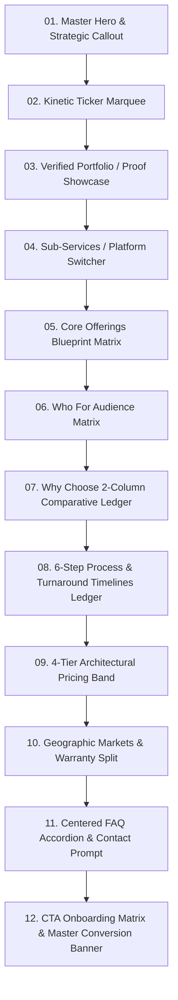

# Frame Cipher — Service Page Master Blueprint Specification
> **Canonical Benchmark:** Production Website Design & Development Pillar Hub (`/services/website-design-development` located at `src/components/services/website-design-development/*`)  
> **Target Audience:** AI Coding Assistants, System Architects & Frontend Engineers  
> **Mandate:** Every Service Page (Pillar Hubs and Sub-Service Pages) across Frame Cipher MUST follow this exact architectural blueprint, visual rhythm, component structure, and design token hierarchy without deviation.

---

## 1. Architectural Philosophy & The 12-Section Anatomy

The UI of `/services/website-design-development` represents Frame Cipher's most refined, cohesive design benchmark. It solves the core problem of B2B/agency websites: **handling dense, high-authority text while maintaining high-tech luxury, fast scannability, and rhythmic visual interest.**

Every complete service page adheres to the **12-Section Canonical Progression**:



---

## 2. Global Design Tokens & Surface Laws

| Token / Layer | Tailwind Class | Hex / Value | Usage & Engineering Rules |
|---|---|---|---|
| **Canvas** | `bg-[#09090B]` | `#09090B` | Deep obsidian page background canvas. Clean, non-distracting. |
| **Surface 1 (Cards)** | `bg-[#121214]` | `#121214` | Primary elevated card surface, matrix cells, and split panels. |
| **Surface 2 (Elevated Boxes)** | `bg-[#18181B]` | `#18181B` | Inner ledger items, why-choose sub-cards, active controls. |
| **Hairline Dividers** | `border-white/[0.08]` | `rgba(255,255,255,0.08)` | Global single-pixel grid borders and section boundaries. |
| **Hover Border Highlight** | `hover:border-white/[0.16]` | `rgba(255,255,255,0.16)` | Smooth interactive boundary brightening. |
| **Brand Signature Accent** | `text-frame-accent` / `bg-frame-accent` | `#9d72ff` / `#A855F7` | Emphasis words in headings (`italic text-frame-accent`), top laser sheens, active tags. |
| **Telemetry Green** | `text-emerald-400` / `border-emerald-500/20` | `#34d399` | Live studio / delivery status pill (`bg-emerald-400 animate-ping`). |
| **Heading Typography** | `font-heading text-white font-medium` | `#FFFFFF` | Solid pure white. **NEVER all-caps**. Always natural Title/Sentence case. |
| **Lead Paragraphs** | `text-zinc-300` | `#D4D4D8` | High-contrast, crystal-clear readability for subheadings and introductions. |
| **Body & Secondary Copy** | `text-zinc-400 group-hover:text-zinc-200` | `#A1A1AA` | Secondary descriptions that gracefully elevate to `zinc-200` on hover. |

### Concentric Radii Hierarchy (Strict Enforcement)
- **Outer Containers & Large Cards:** `rounded-2xl` (20px) or `rounded-xl` (16px)
- **Continuum Grid Outer Wrapper:** `rounded-xl overflow-hidden`
- **Sub-Cards & Inner Ledger Items:** `rounded-lg` (8px)
- **Deliverable Badges & Platform Pills:** `rounded-md` (6px)
- **All Interactive Buttons & Status Indicators:** `rounded-full` (pills)

---

## 3. Section-by-Section Production Blueprints

### Section 01: Master Hero & Strategic Callout (`Hero.jsx`)

The Hero consists of **two coordinated tiers**:
1. **The Header & Display Tier:** Breadcrumbs, live telemetry badge, master 12-column split (H1 with italic signature + symmetrical 52px button pair + technical trust indicators + 3D ambient visual canvas).
2. **The Strategic Callout Tier:** Display H2 + lead paragraph + workflow pipeline pill band + 3-column continuum band + honest assessment callout box.

```jsx
// HERO CODE BLUEPRINT
import React, { useState } from 'react'
import Link from 'next/link'
import { ChevronRight, ShieldCheck } from 'lucide-react'
import PosterButton from '../../home/PosterButton'
import { Ambient3DCanvas } from '../../ui/ambient-3d-canvas'

export default function Hero() {
  const [activeMode, setActiveMode] = useState('mode-1')

  return (
    <div className="relative isolate bg-[#09090B] text-white">
      {/* Background Ambient Glow & Grid */}
      <div className="pointer-events-none absolute inset-0 -z-10 overflow-hidden">
        <div className="absolute top-1/4 left-1/2 -translate-x-1/2 h-[500px] w-[800px] rounded-full bg-purple-600/[0.07] blur-[140px]" />
        <div className="fc-grid-pattern absolute inset-0 opacity-15" />
      </div>

      {/* TOP TIER: Display H1 & Interactive Visual Split */}
      <section className="relative isolate border-b border-white/[0.08] bg-[#09090B] pt-28 pb-16 px-4 sm:px-6 md:px-8">
        <div className="mx-auto max-w-7xl">
          {/* Breadcrumb Navigation & Live Status Row */}
          <div className="mb-8 flex flex-wrap items-center justify-between gap-4 border-b border-white/[0.08] pb-6">
            <nav aria-label="Breadcrumb navigation" className="flex items-center gap-2 font-mono text-[11px] uppercase tracking-[1.1px] text-zinc-400 overflow-x-auto whitespace-nowrap scrollbar-none py-1">
              <Link href="/" className="shrink-0 hover:text-white transition-colors">Home</Link>
              <ChevronRight className="h-3 w-3 text-zinc-600 shrink-0" />
              <Link href="/services" className="shrink-0 hover:text-white transition-colors">Services</Link>
              <ChevronRight className="h-3 w-3 text-zinc-600 shrink-0" />
              <span className="text-frame-accent shrink-0">Service Pillar Title</span>
            </nav>

            <div className="inline-flex items-center gap-2 font-mono text-[11px] uppercase tracking-wider text-emerald-400 bg-[#121214] border border-emerald-500/20 rounded-full px-3.5 py-1">
              <ShieldCheck className="h-3.5 w-3.5 text-emerald-400" />
              <span>Full-Stack Engineering · Dhaka &amp; Global</span>
            </div>
          </div>

          {/* Master 12-Column Side-by-Side Grid */}
          <div className="grid grid-cols-1 gap-10 lg:grid-cols-12 lg:items-center">
            {/* Left Column (6 or 7 cols) */}
            <div className="lg:col-span-6 space-y-6">
              <h1 className="font-heading text-4xl sm:text-6xl lg:text-6xl xl:text-7xl font-medium leading-[0.94] tracking-tight text-white break-normal hyphens-none">
                Core Service Name{' '}
                <span className="italic text-frame-accent inline-block">in Bangladesh.</span>
              </h1>

              <p className="text-base sm:text-lg font-normal leading-relaxed text-zinc-300 max-w-3xl">
                Comprehensive primary introduction describing the exact transformation, execution standards, and business outcomes delivered by Frame Cipher's in-house team.
              </p>

              {/* Symmetrical 52px Button Pair */}
              <div className="flex flex-col sm:flex-row items-stretch sm:items-center gap-4 pt-3">
                <PosterButton href="/contact" variant="accent">
                  Get a Free Proposal &rarr;
                </PosterButton>
                <PosterButton href="#sub-services" variant="outline">
                  Explore Services &rarr;
                </PosterButton>
              </div>

              {/* Technical Trust Meta Indicators */}
              <div className="pt-2 flex flex-wrap items-center gap-3 font-mono text-xs text-zinc-500">
                <span className="h-1 w-1 rounded-full bg-frame-accent" />
                <span>Zero vendor drift</span>
                <span className="text-zinc-700">|</span>
                <span>In-house execution</span>
                <span className="text-zinc-700">|</span>
                <span>Full asset ownership</span>
              </div>
            </div>

            {/* Right Column: 3D Interactive Canvas & Controls (6 cols) */}
            <div className="flex justify-center lg:col-span-6 w-full mt-8 lg:mt-0">
              <div className="w-full max-w-full sm:max-w-[540px] space-y-3">
                {/* Platform Control Bar */}
                <div className="flex items-center justify-between rounded-lg border border-white/[0.08] bg-[#121214] p-1 font-mono w-full gap-1 select-none overflow-x-auto scrollbar-none">
                  {['Mode 1', 'Mode 2', 'Mode 3', 'Mode 4'].map((mode, idx) => (
                    <button
                      key={mode}
                      onClick={() => setActiveMode(`mode-${idx + 1}`)}
                      className={`flex-1 rounded-md py-1.5 px-2 text-center uppercase tracking-wide transition-colors duration-200 text-[10px] sm:text-[11px] ${
                        activeMode === `mode-${idx + 1}`
                          ? 'bg-frame-accent/10 text-frame-accent font-medium shadow-sm border border-frame-accent/40'
                          : 'text-zinc-400 hover:text-white border border-transparent'
                      }`}
                    >
                      {mode}
                    </button>
                  ))}
                </div>
                <Ambient3DCanvas mode={activeMode} className="w-full" />
              </div>
            </div>
          </div>
        </div>
      </section>

      {/* STRATEGIC CALLOUT TIER: Workflow & Architectural Continuum */}
      <section className="relative isolate border-b border-white/[0.08] bg-[#09090B] px-4 py-20 text-white md:px-8 md:py-28">
        <div className="mx-auto max-w-7xl">
          <div className="max-w-3xl space-y-4 mb-12">
            <h2 className="font-heading text-3xl sm:text-4xl md:text-5xl lg:text-6xl font-medium leading-[0.96] tracking-tight text-white">
              Strategic Capability for{' '}
              <span className="italic text-frame-accent">Growing Businesses.</span>
            </h2>
            <p className="text-base sm:text-lg font-normal leading-relaxed text-zinc-300">
              Contextual explanation addressing customer challenges, market realities, and why this service directly impacts growth and retention.
            </p>
          </div>

          {/* Workflow Pipeline Band */}
          <div className="mb-12 flex flex-wrap items-center gap-2 font-mono text-xs uppercase tracking-wider text-zinc-300">
            <span className="rounded-full border border-white/[0.08] bg-[#121214] px-4 py-2 text-zinc-200">Phase 01</span>
            <span className="text-frame-accent">&rarr;</span>
            <span className="rounded-full border border-white/[0.08] bg-[#121214] px-4 py-2 text-zinc-200">Phase 02</span>
            <span className="text-frame-accent">&rarr;</span>
            <span className="rounded-full border border-white/[0.08] bg-[#121214] px-4 py-2 text-zinc-200">Phase 03</span>
            <span className="text-frame-accent">&rarr;</span>
            <span className="rounded-full border border-frame-accent/30 bg-[#18181B] px-4 py-2 text-frame-accent">Compounding Growth</span>
          </div>

          {/* 3-Column Continuum Band */}
          <div className="grid grid-cols-1 border border-white/[0.08] rounded-xl bg-[#121214] overflow-hidden divide-y md:divide-y-0 md:divide-x divide-white/[0.08] md:grid-cols-3 mb-10">
            <div className="p-7 sm:p-8 space-y-4">
              <span className="font-mono text-[11px] uppercase tracking-[1.1px] text-frame-accent">Who We Build For</span>
              <p className="text-sm sm:text-base font-normal leading-relaxed text-zinc-300">
                SMEs, startups, and established enterprises requiring predictable, high-performance systems.
              </p>
            </div>
            <div className="p-7 sm:p-8 space-y-4">
              <span className="font-mono text-[11px] uppercase tracking-[1.1px] text-frame-accent">What We Deliver</span>
              <p className="text-sm sm:text-base font-normal leading-relaxed text-zinc-300">
                End-to-end strategy, technical architecture, asset creation, and continuous performance optimization.
              </p>
            </div>
            <div className="p-7 sm:p-8 space-y-4">
              <span className="font-mono text-[11px] uppercase tracking-[1.1px] text-frame-accent">How We Deliver</span>
              <p className="text-sm sm:text-base font-normal leading-relaxed text-zinc-300">
                One in-house team with zero outsourcing, clear milestone approvals, and dedicated SLA support.
              </p>
            </div>
          </div>

          {/* Honest Assessment Callout Box */}
          <div className="rounded-xl border border-white/[0.08] bg-[#121214] p-6 sm:p-8 flex flex-col sm:flex-row sm:items-center sm:justify-between gap-6">
            <p className="text-sm sm:text-base font-normal leading-relaxed text-zinc-300 max-w-2xl">
              Not sure which level of scope fits your current operational stage? Talk to us and we'll give you a direct, transparent recommendation.
            </p>
            <PosterButton href="/contact" variant="accent" className="shrink-0">
              Get an Honest Assessment &rarr;
            </PosterButton>
          </div>
        </div>
      </section>
    </div>
  )
}
```

---

### Section 02: Kinetic Ticker Marquee (`TypeMarquee`)
Positioned immediately beneath the Hero, rendering high-contrast white text with centered dot dividers (`·`):
```jsx
<TypeMarquee items={['Capability 01', 'Capability 02', 'Capability 03', 'Capability 04']} slow />
```

---

### Section 03: Verified Portfolio & Proof Showcase
Renders real client work with verified screenshots, deliverables tags, and full-width pill action:
```jsx
<WebsitePortfolioPreview
  category="pillar"
  eyebrow="Our Verified Portfolio"
  title="Real Results, Live Systems"
  description="Explore production assets and platforms built by Frame Cipher."
  buttonText="View Project →"
  buttonHref="/projects"
/>
```

---

### Section 04: Core Offerings Blueprint Matrix (`Offerings.jsx`)
Features the signature **Modality 3 Shared Hairline Matrix** with cell-level hover state, high-contrast headings, and full-width card footer buttons:

```jsx
// OFFERINGS MATRIX BLUEPRINT
import React from 'react'
import Link from 'next/link'
import { ArrowRight } from 'lucide-react'

export default function Offerings({ items = [] }) {
  return (
    <section id="sub-services" className="relative isolate border-t border-white/[0.08] bg-[#09090B] px-4 py-20 md:px-8 md:py-28 scroll-mt-24 text-white">
      <div className="mx-auto max-w-7xl">
        <div className="mb-14 flex flex-col gap-6 lg:flex-row lg:items-end lg:justify-between">
          <div className="max-w-2xl space-y-4">
            <h2 className="font-heading text-3xl sm:text-4xl md:text-5xl lg:text-6xl font-medium leading-[0.96] tracking-tight text-white">
              Comprehensive service{' '}
              <span className="italic text-frame-accent">capabilities.</span>
            </h2>
          </div>
          <p className="max-w-md text-base font-normal leading-relaxed text-zinc-300">
            Our full capabilities breakdown spanning strategy, execution, technology, and compounding growth.
          </p>
        </div>

        {/* Modality 3 Continuum Matrix (Shared 1px Hairlines) */}
        <div className="grid grid-cols-1 border-t border-l border-white/[0.08] sm:grid-cols-2 lg:grid-cols-3">
          {items.map((item, idx) => (
            <article
              key={item.title}
              className="group flex flex-col justify-between border-r border-b border-white/[0.08] bg-[#121214] p-8 sm:p-10 transition-colors duration-200 hover:bg-white/[0.02]"
            >
              <div>
                <span className="font-mono text-xs text-frame-accent">0{idx + 1}</span>
                <h3 className="mt-4 font-heading text-xl sm:text-2xl font-medium leading-snug tracking-tight text-white group-hover:text-frame-accent transition-colors">
                  {item.title}
                </h3>
                <p className="mt-3.5 text-sm font-normal leading-relaxed text-zinc-300">
                  {item.description}
                </p>
              </div>

              {/* Card Footer Full-Width Action */}
              <div className="mt-8 border-t border-white/[0.08] pt-4">
                <Link
                  href={item.href || '/contact'}
                  className="inline-flex min-h-[44px] h-[44px] w-full items-center justify-between rounded-full border border-white/[0.14] bg-white/[0.03] px-5 text-[13px] font-medium text-white transition-colors duration-200 hover:border-white/[0.25] hover:bg-white/[0.08]"
                >
                  <span>Explore Details</span>
                  <ArrowRight className="h-3.5 w-3.5 transition-transform duration-200 group-hover:translate-x-1" />
                </Link>
              </div>
            </article>
          ))}
        </div>
      </div>
    </section>
  )
}
```

---

### Section 05: Why Choose 2-Column Comparative Ledger (`WhyChoose.jsx`)
Contrasts the **Compounding Cost of Weak Execution** vs. **The Frame Cipher Standard**:

```jsx
// WHY CHOOSE COMPARATIVE LEDGER
import React from 'react'
import PosterButton from '../../home/PosterButton'

export default function WhyChoose({ weakPoints = [], advantages = [] }) {
  return (
    <section className="relative isolate border-t border-white/[0.08] bg-[#09090B] px-4 py-20 md:px-8 md:py-28 text-white">
      <div className="mx-auto max-w-7xl">
        <div className="mb-14 flex flex-col gap-6 lg:flex-row lg:items-end lg:justify-between">
          <div className="max-w-2xl space-y-4">
            <h2 className="font-heading text-3xl sm:text-4xl md:text-5xl lg:text-6xl font-medium leading-[0.96] tracking-tight text-white">
              Why execution quality matters for{' '}
              <span className="italic text-frame-accent">business growth.</span>
            </h2>
          </div>
          <p className="max-w-md text-base font-normal leading-relaxed text-zinc-300">
            Fragmented execution is the hidden tax on your business. Here is how accountability changes the outcome.
          </p>
        </div>

        <div className="grid gap-8 lg:grid-cols-2 lg:items-start">
          {/* Left Column: Compounding Costs */}
          <div className="rounded-xl border border-white/[0.08] bg-[#121214] p-8 sm:p-10 flex flex-col justify-between">
            <div>
              <h3 className="font-heading text-2xl sm:text-3xl font-medium tracking-tight text-white">
                The Compounding Cost of Weak Execution
              </h3>
              <div className="mt-8 space-y-4">
                {weakPoints.map((item, idx) => (
                  <div key={idx} className="flex items-start gap-4 rounded-lg border border-white/[0.04] bg-[#18181B] p-5 transition-colors hover:border-white/[0.08]">
                    <span className="font-mono text-xs uppercase text-frame-accent mt-0.5">0{idx + 1}</span>
                    <div>
                      <h4 className="font-heading text-base font-medium text-white">{item.title}</h4>
                      <p className="mt-1 text-sm font-normal leading-relaxed text-zinc-300">{item.desc}</p>
                    </div>
                  </div>
                ))}
              </div>
            </div>
            <div className="mt-8 pt-6 border-t border-white/[0.08]">
              <PosterButton href="/contact" variant="accent">Book a Strategy Session &rarr;</PosterButton>
            </div>
          </div>

          {/* Right Column: Frame Cipher Advantages */}
          <div className="rounded-xl border border-white/[0.08] bg-[#121214] p-8 sm:p-10">
            <h3 className="font-heading text-2xl sm:text-3xl font-medium tracking-tight text-white">
              The Frame Cipher Standard
            </h3>
            <div className="mt-8 space-y-4">
              {advantages.map((item, idx) => (
                <div key={idx} className="rounded-lg border border-white/[0.04] bg-[#18181B] p-5 transition-colors hover:border-white/[0.08]">
                  <div className="flex items-baseline gap-3">
                    <span className="font-mono text-xs text-frame-accent">0{idx + 1}</span>
                    <h4 className="font-heading text-base font-medium text-white">{item.title}</h4>
                  </div>
                  <p className="mt-2 text-sm font-normal leading-relaxed text-zinc-300">{item.desc}</p>
                </div>
              ))}
            </div>
          </div>
        </div>
      </div>
    </section>
  )
}
```

---

### Section 06: Process & Turnaround Timelines Ledger (`Process.jsx`)
Combines a **6-Step Milestones Matrix** with an explicit **Turnaround Timelines Architectural Ledger**:

```jsx
// PROCESS & TIMELINES LEDGER
import React from 'react'

export default function Process({ steps = [], timelines = [] }) {
  return (
    <section className="relative isolate border-t border-white/[0.08] bg-[#09090B] px-4 py-20 md:px-8 md:py-28 text-white">
      <div className="mx-auto max-w-7xl">
        <div className="mb-14 flex flex-col gap-6 lg:flex-row lg:items-end lg:justify-between">
          <div className="max-w-2xl space-y-4">
            <h2 className="font-heading text-3xl sm:text-4xl md:text-5xl lg:text-6xl font-medium leading-[0.96] tracking-tight text-white">
              Our 6-step engineering{' '}
              <span className="italic text-frame-accent">process.</span>
            </h2>
          </div>
          <p className="max-w-md text-base font-normal leading-relaxed text-zinc-300">
            A disciplined, milestone-governed workflow from kickoff through deployment and ongoing growth.
          </p>
        </div>

        {/* 6-Step Continuum Matrix */}
        <div className="grid grid-cols-1 border-t border-l border-white/[0.08] sm:grid-cols-2 lg:grid-cols-3">
          {steps.map((step) => (
            <div key={step.number} className="group flex flex-col justify-between border-r border-b border-white/[0.08] bg-[#121214] p-8 sm:p-10 transition-colors duration-200 hover:bg-white/[0.02]">
              <div>
                <h3 className="font-heading text-xl sm:text-2xl font-medium tracking-tight text-white group-hover:text-frame-accent transition-colors">
                  {step.title}
                </h3>
                <p className="mt-3.5 text-sm font-normal leading-relaxed text-zinc-300">
                  {step.description}
                </p>
              </div>
              <div className="mt-8 border-t border-white/[0.08] pt-4">
                <span className="font-mono text-[10px] uppercase tracking-[1.1px] text-zinc-500 block">Deliverable</span>
                <span className="mt-1 font-heading text-xs text-zinc-200 block">{step.deliverable}</span>
              </div>
            </div>
          ))}
        </div>

        {/* Turnaround Timelines Ledger */}
        <div className="mt-10 rounded-xl border border-white/[0.08] bg-[#121214] p-6 sm:p-8">
          <div className="flex items-center gap-2 mb-4">
            <span className="h-1.5 w-1.5 rounded-full bg-frame-accent" />
            <h3 className="font-mono text-xs tracking-[1.1px] text-frame-accent">Typical Turnaround Timelines</h3>
          </div>
          <div className="grid grid-cols-1 sm:grid-cols-2 lg:grid-cols-4 gap-4 divide-y sm:divide-y-0 sm:divide-x divide-white/[0.08]">
            {timelines.map((item, i) => (
              <div key={i} className="pt-3 sm:pt-0 sm:px-4 first:pl-0 last:pr-0 space-y-1">
                <span className="font-heading text-sm font-medium text-white block">{item.type}</span>
                <span className="font-mono text-xs text-frame-accent block">{item.time}</span>
                <p className="text-xs text-zinc-400 leading-normal">{item.note}</p>
              </div>
            ))}
          </div>
        </div>
      </div>
    </section>
  )
}
```

---

### Section 07: 4-Tier Architectural Column Band (`Pricing.jsx`)
Features a 4-column divided band with high-contrast prices, green checkmarks, and full-width buttons:

```jsx
// 4-TIER PRICING BAND
import React from 'react'
import { Check } from 'lucide-react'
import PosterButton from '../../home/PosterButton'

export default function Pricing({ packages = [] }) {
  return (
    <section id="pricing" className="relative isolate border-t border-white/[0.08] bg-[#09090B] px-4 py-20 md:px-8 md:py-28 scroll-mt-20 text-white">
      <div className="mx-auto max-w-7xl">
        <div className="mb-14 flex flex-col gap-6 lg:flex-row lg:items-end lg:justify-between">
          <div className="max-w-2xl space-y-4">
            <h2 className="font-heading text-3xl sm:text-4xl md:text-5xl lg:text-6xl font-medium leading-[0.96] tracking-tight text-white">
              Transparent, scope-backed{' '}
              <span className="italic text-frame-accent">pricing.</span>
            </h2>
          </div>
          <p className="max-w-md text-base font-normal leading-relaxed text-zinc-300">
            Investment levels based on actual scope, technical complexity, and agreed deliverables. No hidden surcharges.
          </p>
        </div>

        {/* 4-Column Divided Band */}
        <div className="grid grid-cols-1 border border-white/[0.08] rounded-xl bg-[#121214] overflow-hidden divide-y md:divide-y-0 md:divide-x divide-white/[0.08] md:grid-cols-2 lg:grid-cols-4">
          {packages.map((pkg, i) => (
            <div
              key={i}
              className={`p-7 sm:p-8 flex flex-col justify-between transition-colors duration-200 ${
                pkg.featured ? 'bg-white/[0.02]' : 'hover:bg-white/[0.01]'
              }`}
            >
              <div>
                <h3 className="font-heading text-xl font-medium text-white">{pkg.name}</h3>
                <p className="mt-3 font-heading text-xl sm:text-2xl font-medium text-white tabular-nums">{pkg.price}</p>
                <p className="mt-2 text-xs font-normal leading-relaxed text-zinc-400">{pkg.description}</p>
                <div className="mt-6 border-t border-white/[0.08] pt-5">
                  <ul className="space-y-3">
                    {pkg.features.map((feat, fIdx) => (
                      <li key={fIdx} className="flex items-start gap-2.5 text-xs font-normal text-zinc-300">
                        <Check className="mt-0.5 h-3.5 w-3.5 shrink-0 text-frame-accent" />
                        <span>{feat}</span>
                      </li>
                    ))}
                  </ul>
                </div>
              </div>

              <div className="mt-8 border-t border-white/[0.08] pt-6">
                <PosterButton href="/contact" variant={pkg.featured ? 'accent' : 'outline'} className="w-full justify-center">
                  Request Quote &rarr;
                </PosterButton>
              </div>
            </div>
          ))}
        </div>
      </div>
    </section>
  )
}
```

---

### Section 08: Geographic Markets & Warranty Split (`Markets.jsx`)
Features a **2-Column Divided Band** (Domestic vs. International Markets) and a **Warranty and Ongoing Support Card**:

```jsx
// MARKETS & WARRANTY
import React from 'react'
import { Check } from 'lucide-react'

export default function Markets({ domesticPoints = [], globalPoints = [] }) {
  return (
    <section className="relative isolate border-t border-white/[0.08] bg-[#09090B] px-4 py-20 md:px-8 md:py-28 text-white">
      <div className="mx-auto max-w-7xl">
        <div className="mb-14 flex flex-col gap-6 lg:flex-row lg:items-end lg:justify-between">
          <div className="max-w-2xl space-y-4">
            <h2 className="font-heading text-3xl sm:text-4xl md:text-5xl lg:text-6xl font-medium leading-[0.96] tracking-tight text-white">
              Service delivery for Bangladesh{' '}
              <span className="italic text-frame-accent">and worldwide.</span>
            </h2>
          </div>
          <p className="max-w-md text-base font-normal leading-relaxed text-zinc-300">
            Headquartered in Dhaka with global operational reach across the US, UK, Australia, Canada, and UAE.
          </p>
        </div>

        {/* 2-Column Market Split */}
        <div className="grid grid-cols-1 border border-white/[0.08] rounded-xl bg-[#121214] overflow-hidden divide-y lg:divide-y-0 lg:divide-x divide-white/[0.08] lg:grid-cols-2">
          <div className="p-8 sm:p-10 flex flex-col justify-between space-y-6">
            <div>
              <h3 className="font-heading text-xl sm:text-2xl font-medium text-white">Domestic Market Excellence</h3>
              <ul className="mt-6 space-y-3 border-t border-white/[0.08] pt-5">
                {domesticPoints.map((pt, idx) => (
                  <li key={idx} className="flex items-start gap-2.5 text-xs sm:text-sm font-normal text-zinc-300">
                    <Check className="mt-0.5 h-3.5 w-3.5 shrink-0 text-frame-accent" />
                    <span>{pt}</span>
                  </li>
                ))}
              </ul>
            </div>
            <div className="border-t border-white/[0.08] pt-4 font-mono text-xs text-zinc-500">
              Dhaka Studio Headquarters · Serving Clients Nationwide
            </div>
          </div>

          <div className="p-8 sm:p-10 flex flex-col justify-between space-y-6">
            <div>
              <h3 className="font-heading text-xl sm:text-2xl font-medium text-white">International Market Operations</h3>
              <ul className="mt-6 space-y-3 border-t border-white/[0.08] pt-5">
                {globalPoints.map((pt, idx) => (
                  <li key={idx} className="flex items-start gap-2.5 text-xs sm:text-sm font-normal text-zinc-300">
                    <Check className="mt-0.5 h-3.5 w-3.5 shrink-0 text-frame-accent" />
                    <span>{pt}</span>
                  </li>
                ))}
              </ul>
            </div>
            <div className="border-t border-white/[0.08] pt-4 font-mono text-xs text-zinc-500">
              Serving businesses across US, UK, Australia, Canada &amp; UAE
            </div>
          </div>
        </div>

        {/* Warranty Card */}
        <div className="mt-10 rounded-xl border border-white/[0.08] bg-[#121214] p-8 sm:p-10">
          <h3 className="font-heading text-2xl sm:text-3xl font-medium text-white">
            Production Warranty and Ongoing SLA
          </h3>
          <div className="mt-4 grid gap-6 md:grid-cols-2 text-sm font-normal leading-relaxed text-zinc-300">
            <p>Every delivery undergoes milestone verification before handoff, ensuring total alignment with business goals.</p>
            <p>Includes complete warranty coverage against defects and performance degradation during post-launch operations.</p>
          </div>
        </div>
      </div>
    </section>
  )
}
```

---

### Section 09: Strictly Centered FAQ Accordion & Contact Prompt (`FAQ.jsx`)

```jsx
// CENTERED FAQ ACCORDION
'use client'

import React, { useState } from 'react'
import { ChevronDown, ChevronUp } from 'lucide-react'
import PosterButton from '../../home/PosterButton'

export default function FAQ({ faqs = [] }) {
  const [openIndex, setOpenIndex] = useState(null)

  const toggleFaq = (idx) => setOpenIndex(openIndex === idx ? null : idx)

  return (
    <section className="relative isolate border-t border-white/[0.08] bg-[#09090B] px-4 py-20 text-white md:px-8 md:py-28">
      <div className="mx-auto max-w-7xl">
        {/* Strictly Centered Section Header */}
        <div className="mx-auto max-w-3xl text-center space-y-4 mb-14">
          <h2 className="font-heading text-3xl sm:text-4xl md:text-5xl lg:text-6xl font-medium leading-[0.96] tracking-tight text-white">
            Frequently asked{' '}
            <span className="italic text-frame-accent">questions.</span>
          </h2>
          <p className="text-base sm:text-lg font-normal leading-relaxed text-zinc-300">
            Direct answers regarding scope, deliverables, pricing, and ongoing operational support.
          </p>
        </div>

        {/* Centered Accordions */}
        <div className="mx-auto max-w-4xl space-y-3">
          {faqs.map((faq, index) => {
            const isOpen = openIndex === index
            return (
              <div key={index} className="rounded-xl border border-white/[0.08] bg-[#121214] transition-colors duration-200 hover:border-white/[0.14]">
                <button
                  type="button"
                  onClick={() => toggleFaq(index)}
                  className="flex w-full items-center justify-between p-6 text-left"
                  aria-expanded={isOpen}
                >
                  <span className="font-heading text-lg sm:text-xl font-medium leading-snug tracking-tight text-white pr-4">
                    {faq.question}
                  </span>
                  <span className="shrink-0 rounded-full border border-white/[0.08] bg-[#18181B] p-2 text-zinc-400">
                    {isOpen ? <ChevronUp className="h-4 w-4 text-frame-accent" /> : <ChevronDown className="h-4 w-4" />}
                  </span>
                </button>
                {isOpen && (
                  <div className="border-t border-white/[0.08] px-6 pb-6 pt-4">
                    <p className="text-base font-normal leading-relaxed text-zinc-300">{faq.answer}</p>
                  </div>
                )}
              </div>
            )
          })}
        </div>

        {/* Contact Prompt Callout */}
        <div className="mt-12 rounded-xl border border-white/[0.08] bg-[#121214] p-8 flex flex-col sm:flex-row sm:items-center sm:justify-between gap-6 max-w-4xl mx-auto">
          <p className="text-sm sm:text-base font-medium text-white max-w-xl">
            Have a specific requirement or questions about your timeline? Contact our engineers directly for straight answers.
          </p>
          <PosterButton href="/contact" variant="accent" className="shrink-0">
            Talk to Our Team &rarr;
          </PosterButton>
        </div>
      </div>
    </section>
  )
}
```

---

### Section 10: Onboarding Matrix & Master Conversion Banner (`CTA.jsx`)

```jsx
// ONBOARDING MATRIX & MASTER CONVERSION BANNER
import React from 'react'
import PosterButton from '../../home/PosterButton'

export default function CTA({ onboardingSteps = [] }) {
  return (
    <section id="cta" className="relative isolate border-t border-white/[0.08] bg-[#09090B] px-4 py-20 md:px-8 md:py-28 scroll-mt-20 text-white">
      <div className="mx-auto max-w-7xl">
        <div className="mb-14 flex flex-col gap-6 lg:flex-row lg:items-end lg:justify-between">
          <div className="max-w-2xl space-y-4">
            <h2 className="font-heading text-3xl sm:text-4xl md:text-5xl lg:text-6xl font-medium leading-[0.96] tracking-tight text-white">
              What happens next after{' '}
              <span className="italic text-frame-accent">you contact us?</span>
            </h2>
          </div>
          <p className="max-w-md text-base font-normal leading-relaxed text-zinc-300">
            A clear, predictable path from initial consultation to final launch and handover.
          </p>
        </div>

        {/* 6-Step Onboarding Matrix */}
        <div className="grid grid-cols-1 border-t border-l border-white/[0.08] sm:grid-cols-2 lg:grid-cols-3">
          {onboardingSteps.map((item) => (
            <div key={item.step} className="group flex flex-col justify-between border-r border-b border-white/[0.08] bg-[#121214] p-8 sm:p-10 transition-colors duration-200 hover:bg-white/[0.02]">
              <div>
                <span className="font-mono text-xs text-frame-accent">{item.step}</span>
                <h3 className="mt-3 font-heading text-xl sm:text-2xl font-medium tracking-tight text-white group-hover:text-frame-accent transition-colors">
                  {item.title}
                </h3>
                <p className="mt-3.5 text-sm font-normal leading-relaxed text-zinc-300">
                  {item.description}
                </p>
              </div>
            </div>
          ))}
        </div>

        {/* Master Conversion Banner */}
        <div className="mt-14 rounded-xl border border-white/[0.08] bg-[#121214] p-8 sm:p-12 flex flex-col lg:flex-row lg:items-center lg:justify-between gap-8">
          <div className="max-w-2xl space-y-3">
            <h3 className="font-heading text-2xl sm:text-4xl font-medium tracking-tight text-white">
              Ready to build your next project?
            </h3>
            <p className="text-base font-normal leading-relaxed text-zinc-300">
              Get a free strategy call and discover what we would build for your brand. Clear timelines, transparent quotes, zero vendor friction.
            </p>
          </div>

          <div className="flex flex-col sm:flex-row items-stretch sm:items-center gap-4 shrink-0">
            <PosterButton href="/contact" variant="accent">
              Get a Free Quote &rarr;
            </PosterButton>
            <PosterButton href="/contact" variant="outline">
              Talk to Our Team &rarr;
            </PosterButton>
          </div>
        </div>
      </div>
    </section>
  )
}
```

---

## 4. Universal Checklist for Any Service Page Refactor

Before considering any service page complete, verify against these 10 Golden Criteria:

- [ ] **1. Two-Tier Hero Structure:** Header tier with breadcrumbs and live telemetry badge + 12-col side-by-side display tier + Callout tier with workflow pipeline band and 3-column continuum band.
- [ ] **2. Display Typography:** Headings in solid pure white (`text-white font-medium`) with `<span className="italic text-frame-accent">...</span>`. ZERO `uppercase` on H1/H2/H3.
- [ ] **3. Color Contrast:** Lead paragraphs in `text-zinc-300`. Descriptions in `text-zinc-400 group-hover:text-zinc-200`. Zero washed-out `#A1A1AA` bodies.
- [ ] **4. Concentric Radii:** All grids use `rounded-xl overflow-hidden`. All feature boxes use `rounded-xl` or `rounded-2xl`. All buttons and live badges use `rounded-full`.
- [ ] **5. Shared Hairline Continuum:** Matrix grids use `border-t border-l border-white/[0.08]` with cells `border-r border-b border-white/[0.08] bg-[#121214] hover:bg-white/[0.02]`.
- [ ] **6. Symmetrical Buttons:** All primary and secondary CTAs use `PosterButton` (`rounded-full`, 52px height, animated sliding arrow `→`).
- [ ] **7. Full-Width Card Footers:** Matrix cards feature rounded pill action buttons with `ArrowRight` hover translation.
- [ ] **8. 2-Column Comparative Ledger:** Why Choose is split into Compounding Costs vs. Frame Cipher Advantages in `bg-[#18181B]` cards.
- [ ] **9. Turnaround Timelines Ledger:** Process section includes a dedicated turnaround times strip with dot indicators.
- [ ] **10. Zero Content Loss:** 100% of user-provided copy, deliverables, SLAs, pricing notes, and FAQ answers preserved word-for-word.

